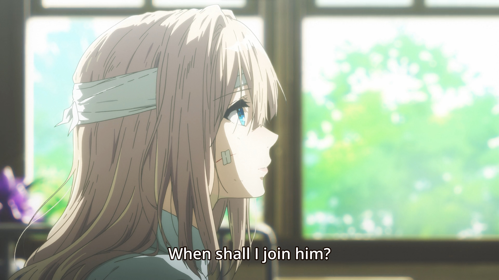

# normalasser

A CLI tool that extracts [ASS subtitles](https://en.wikipedia.org/wiki/SubStation_Alpha) from [MKV video files](https://en.wikipedia.org/wiki/Matroska) and normalizes their appearance for more consistent, readable subtitles. ASS files embed choices such as font, color, size, and positioning, which can make subtitles vary significantly between series and sources. This tool normalizes the primary subtitle size while preserving the remaining styling and original presentation as much as possible.

## Preview

<table width="100%">
  <tr>
    <td width="50%">Before</td>
    <td width="50%">After</td>
  </tr>
  <tr>
    <td width="50%"></td>
    <td width="50%"></td>
  </tr>
  <tr>
    <td width="50%"></td>
    <td width="50%"></td>
  </tr>
  <tr>
    <td width="50%"></td>
    <td width="50%"></td>
  </tr>
  <tr>
    <td width="50%"></td>
    <td width="50%"></td>
  </tr>
</table>

## Prerequisites

When not using docker, [ffmpeg](https://ffmpeg.org/) 8+ must be installed, with `ffmpeg` and `ffprobe` on `PATH`.

## Quick Start

Run with **docker**:

```bash
docker run -p 7883:7883 -v /path/to/media:/path/to/media deathspike/normalasser
```

Then submit a file or directory path:

```bash
curl -d '"/path/to/media"' http://localhost:7883/
```

Or run with **npm (using npx)**:

```bash
npx normalasser /path/to/file-or-directory
```

## Installation

The Quick Start commands are for one-off runs to quickly try the tool, while the options below are intended for regular use. You can set up a persistent environment with Docker Compose, install the CLI globally with npm, or clone from source if you want full control or plan to contribute.

### Docker Compose

```yaml
services:
  normalasser:
    image: deathspike/normalasser
    container_name: normalasser
    restart: always
    ports:
      - 7883:7883
    volumes:
      - /path/to/media:/path/to/media
```

### npm

Install globally with **npm**:

```bash
npm install -g normalasser
```

Then run:

```bash
normalasser /path/to/file-or-directory
```

### From Source

Install from source with **git** and **npm**:

```bash
git clone https://github.com/Deathspike/normalasser
cd normalasser
npm install
```

Then run with **node**:

```bash
node bin/cli.js /path/to/file-or-directory
```

## Configuration

You can configure this tool either with a CLI option when running through npm or from source, or with an environment variable when running in Docker. If no value is provided, the tool falls back to the default value shown in the table below.

| CLI                   | Docker          | Default | Description                                                                                                                             |
| --------------------- | --------------- | ------- | --------------------------------------------------------------------------------------------------------------------------------------- |
| **`--check-ass`**     | **`CHECK_ASS`** | `false` | Normalize existing ASS subtitle files during directory scans, including those extracted by an earlier run.                              |
| **`--force-mkv`**     | **`FORCE_MKV`** | `false` | Extract and normalize ASS subtitles from MKV video files during directory scans, even if matching external ASS subtitles already exist. |
| **`--size <number>`** | **`SIZE`**      | `16`    | Base font size for the primary subtitle style. Other styles are scaled proportionally.                                                  |
|                       | **`PORT`**      | `7883`  | The port the embedded HTTP server listens on.                                                                                           |

For example:

```bash
normalasser --force-mkv /path/to/file-or-directory
```

## Docker Server

The docker image runs an HTTP server for automation. Send any JSON payload in a `POST` request to the server, and the server will recursively queue every absolute path it finds. Because no fixed schema is required, it works with virtually any JSON webhook that includes an absolute path, including those from [Radarr](https://github.com/Radarr/Radarr) and [Sonarr](https://github.com/Sonarr/Sonarr/). Fields with names containing `Delete` or `Remove` are ignored. The server returns `204` for valid JSON, `400` for malformed JSON, and `404` for other HTTP methods. Queued paths are processed asynchronously, with progress reported in the container logs.

## Contributions

Pull requests are welcome! Please open an issue first to discuss major changes.
